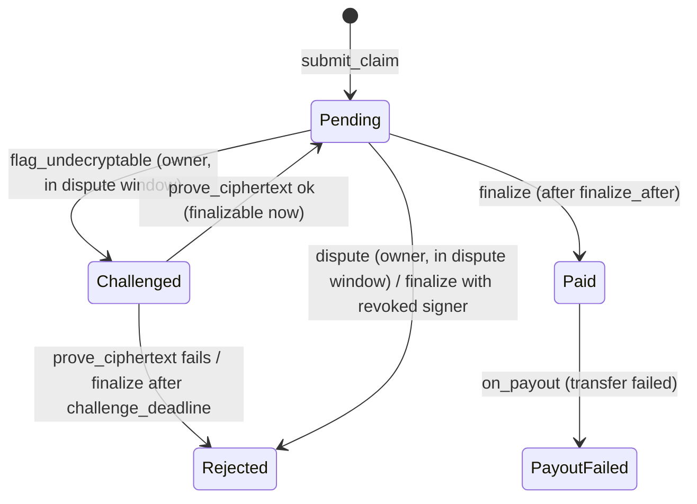

# sealed-bounty (escrow contract, v3)

Bug-bounty escrow that pays a hunter when a **NEAR AI Cloud TEE-signed** judge verdict says the
report is valid. Each program pins what the judge saw: the system prompt (`system_prompt_hash`), the
code bundle (`code_hash`), the request params (`params_hash`), the model (`model_id`) and the signer
set (`signers`). The owner can reveal the request to dispute a claim. If the encrypted report can't be
decrypted, the owner can challenge it, and the hunter must then prove the ciphertext. Hunters post a
bond. The spec is [`docs/INTERFACE.md`](../../docs/INTERFACE.md) (v3 section), but this README is
written from `src/lib.rs`, and `tests/readme_methods.rs` checks that every `pub fn` is listed here.

## State
`Contract`:
| Field | Type | Notes |
|---|---|---|
| `owner` | `AccountId` | admin, controls the signer allowlist |
| `signers` | `IterableMap<Signer, SignerMeta>` | global allowlist. `Signer` = `"ed25519:<64 hex>"` or `"eth:0x<40 hex>"`. `SignerMeta = {kind: "provider_tee" \| "gateway", model: Option<String>}` |
| `programs` | `IterableMap<u64, Program>` | ids start at 0 |
| `claims` | `IterableMap<u64, Claim>` | ids start at 0, global across programs |
| `claims_by_program` | `LookupMap<u64, Vector<u64>>` | per-program claim ids in submission order (paginated by `list_claims`) |
| `used_req_hashes` | `LookupSet<String>` | dedupe key `"<program_id>:<req_hash>"`, so duplicates are checked per program |
| `revoked` | `LookupSet<Signer>` | signers revoked by the admin. Their pending claims are rejected at `finalize` |
| `next_program_id`, `next_claim_id` | `u64` | |

`Program`: `id, owner, name, repo_url, commit, model_id, system_prompt_hash, code_hash, params_hash,
signers: Vec<Signer>, bond: U128, challenge_secs, payouts: {low, medium, high, critical}: U128,
owner_enc_pubkey (base64 x25519), dispute_secs, min_confidence: u8, balance: U128 (unreserved pool),
reserved: U128 (sum of Pending payouts), open, created_at`.

`Claim`: `id, program_id, hunter, req_hash, resp_hash (sha256 of resp_body; the body itself is not
stored), verdict: {valid, severity, cwe?, confidence}, signer, kind, signature, model, ciphertext,
status, payout, submitted_at, finalize_after, reject_reason?, bond, challenge_deadline?`.

`status` ∈ `Pending`, `Challenged`, `Rejected`, `Paid`, `PayoutFailed`.

## Claim lifecycle

- Rejected: the payout goes from `reserved` back to `balance`, and the hunter's bond is forfeited to `balance`.
- Paid: the contract transfers `payout + bond` to the hunter. If that transfer fails, `on_payout` sets
  `PayoutFailed` and credits `payout + bond` back to `balance`.
- `Rejected`, `Paid` and `PayoutFailed` are terminal.

## Dispute reason order
`dispute(claim_id, request_body)` requires sha256(`request_body`) = `claim.req_hash`. It then rejects
the claim with the FIRST failing reason (`tamper_reason` in `src/lib.rs`). `prove_ciphertext` runs
the same checks on the decrypted body.
1. `system prompt tampered`: the body is not valid JSON or doesn't have the basic `{model, messages}` shape, there are more than 3 messages, `messages[0]` is not `system`, or the sha256 of its content ≠ `system_prompt_hash`
2. `model mismatch`: `model` ≠ `program.model_id`
3. `params tampered`: the top-level keys are not exactly `model, messages, response_format, chat_template_kwargs, temperature, max_tokens`, a message is not exactly `{role, content}`, a key is duplicated anywhere, or the sha256 of the canonical JSON (keys sorted recursively, compact) of `{chat_template_kwargs, max_tokens, response_format, temperature}` ≠ `params_hash`
   - Numbers (#15): canonical JSON prints serde_json's `Value`, so an integer token that fits u64/i64 stays as written (`0`, `400`) and anything else becomes an f64 printed by serde_json (`0.0` → `0.0`, `-0` → `-0.0`, `1e2` → `100.0`, `1e16` → `1e+16`); `1e400` fails the parse. `shared/judge.mjs` `requestParamsHash` / `checkRequestAgainstProgram` replay this exactly; `tests/fixtures/canonical-vectors.json` is the cross-language reference (regenerate with `UPDATE_VECTORS=1 cargo test canonical_number_vectors`).
   - Hardening in source, NOT deployed (`STRICT_PARAM_NUMBERS`, next deploy): any non-integer number in the params is `params tampered`. The deployed `sealedbounty-v3.testnet` accepts float params whose canonical form matches; JS models the hardening with `{strictNumbers: true}`.
4. `code mismatch`: `messages[1]` is not a `user` message equal to `TARGET <repo_url>@<commit>\nHUNTER <hunter>\n\nCODE\n<bundle>` with sha256(bundle) = `code_hash`. The TARGET line, the framing and the hash are checked before the HUNTER line.
5. `hunter mismatch`: everything in `messages[1]` matches except the HUNTER line ≠ `claim.hunter` (a front-run). This also releases the dedupe key, so the real hunter can resubmit the same signed verdict.
6. `report missing`: `messages[2]` is missing, is not `user`, or doesn't start with `REPORT\n`

If every check passes, `dispute` panics with `dispute invalid: request matches program`.

Other rejection reasons: `undecryptable report` (from `prove_ciphertext`, or `finalize` on a
Challenged claim after the deadline) and `signer revoked` (from `finalize`).

## Methods
"Who" is enforced by the contract. Calls are non-payable unless marked **payable**.

### Admin (signer allowlist)
| Method | Who | Effect | Panics |
|---|---|---|---|
| `new(owner: Option<AccountId>)` | init | admin = `owner` or the caller | |
| `add_signer(signer, meta: SignerMeta)` | admin | inserts or overwrites the entry. Emits `signer_added`. Existing programs keep their own signer snapshot | `owner only` |
| `remove_signer(signer) -> bool` | admin | removes the signer from the allowlist. Emits `signer_removed` if it was present. Pending claims are not affected | `owner only` |
| `revoke_signer(signer) -> bool` | admin | removes the signer from the allowlist and adds it to `revoked`, so its pending claims are rejected at `finalize`. Emits `signer_revoked` if newly revoked | `owner only` |

### Programs
| Method | Who | Effect | Panics |
|---|---|---|---|
| `create_program(name, repo_url, commit, model_id, system_prompt_hash, code_hash, params_hash, payouts, owner_enc_pubkey, dispute_secs, min_confidence, bond: U128, challenge_secs, signers: Option<Vec<Signer>>) -> u64` | anyone, **payable** | caller becomes the program owner. The hashes are stored lowercase. `signers` = None → every allowlisted signer whose `meta.model == model_id`. Some(list) → each entry must be allowlisted with that model (duplicates are dropped). `balance` = deposit − storage. Emits `program_created` | `system_prompt_hash must be 64 hex chars`, `code_hash must be 64 hex chars`, `params_hash must be 64 hex chars`, `min_confidence must be <= 100`, `dispute_secs too large`, `challenge_secs too large`, `signer not allowlisted`, `no signers for model`, `insufficient storage deposit` |
| `set_program_signers(program_id, signers: Vec<Signer>)` | program owner, **payable** (storage growth; the rest is refunded) | replaces `program.signers` (same subset rule). Only future submissions use the new set. Emits `program_signers_set` | `program not found`, `program owner only`, `signer not allowlisted`, `no signers for model`, `insufficient storage deposit` |
| `fund_program(program_id)` | anyone, **payable** | adds the deposit to `balance`. Emits `program_funded` | `attach a deposit`, `program not found`, `program closed` |
| `close_program(program_id)` | program owner | sets `open = false` and refunds `balance`. `reserved` stays for pending claims. Can be called again to sweep funds that come back later (rejections, failed payouts). Emits `program_closed` | `program not found`, `program owner only` |

### Claims
| Method | Who | Effect | Panics |
|---|---|---|---|
| `submit_claim(program_id, req_hash, resp_body: Base64VecU8, signature, signer, kind, ciphertext) -> u64` | hunter (caller), **payable** (storage + `program.bond`; the rest is refunded) | verifies the TEE signature against `program.model_id`, parses the verdict, moves the payout from `balance` to `reserved`, and sets `finalize_after = now + dispute_secs`. Emits `claim_submitted` | `program not found`, `program closed`, `signer not allowlisted` (not in `program.signers` or not in the global allowlist), `signer kind mismatch`, `req_hash must be 64 hex chars`, `bad signature`, `bad completion json: ...`, `missing choices[0].message.content`, `bad verdict json: ...`, `verdict not payable` (invalid, severity none, or confidence < `min_confidence`), `already claimed`, `insufficient pool`, `insufficient storage deposit`, `insufficient bond` |
| `dispute(claim_id, request_body: String)` | program owner, while Pending and `now < finalize_after` | → Rejected with the first failing reason (see above) | `claim not found`, `program owner only`, `claim not pending`, `dispute window closed`, `body mismatch`, `dispute invalid: request matches program` |
| `flag_undecryptable(claim_id)` | program owner, while Pending and `now < finalize_after` | → Challenged with `challenge_deadline = now + challenge_secs`. Emits `claim_challenged` | `claim not found`, `program owner only`, `claim not pending`, `dispute window closed` |
| `prove_ciphertext(claim_id, ephemeral_secret: String /* 64 hex */)` | claim hunter, while Challenged and `now < challenge_deadline` | opens the nacl box with the ephemeral secret and the owner's key. If it doesn't open, or sha256(plaintext) ≠ `req_hash` → Rejected `undecryptable report`. Otherwise it runs the dispute checks: a failing reason → Rejected with that reason, and if all pass → Pending with `finalize_after = now`. Emits `claim_proven` or `claim_rejected` | `claim not found`, `claim hunter only`, `claim not challenged`, `challenge closed`, `ephemeral_secret must be 64 hex chars` |
| `finalize(claim_id) -> PromiseOrValue<()>` | anyone | Challenged after the deadline → Rejected `undecryptable report`. Pending with a revoked signer → Rejected `signer revoked`. Otherwise → Paid, then transfers `payout + bond` to the hunter and calls `on_payout` (10 Tgas). Emits `claim_paid` or `claim_rejected` | `claim not found`, `challenge open`, `claim not pending`, `dispute window open` |
| `on_payout(claim_id) -> bool` | contract only (`#[private]`), as the callback of `finalize` | if the transfer failed: Paid → PayoutFailed, and `payout + bond` goes back to `balance`. Emits `payout_failed` | `Method on_payout is private`, `claim not found`, `claim not paid` |

### Views
| Method | Returns |
|---|---|
| `get_owner()` | `AccountId` |
| `get_signers()` | `Vec<(Signer, SignerMeta)>` |
| `is_signer_revoked(signer)` | `bool` |
| `get_program(id)` | `Option<Program>` |
| `list_programs(from_index?, limit?)` | programs with id ≥ `from_index`, up to `limit` (default 50) |
| `get_claim(id)` | `Option<Claim>` |
| `list_claims(program_id, from_index?, limit?)` | claims of that program in submission order. Skips the first `from_index` and returns up to `limit` (default 50). The cost is O(page) |
| `verify_tee_response(model, req_hash, resp_body, signature, signer, kind)` | `Verdict`. No state change; callable as a free RPC view (used by the guided tour's "Ask the contract"). Panics `signer not allowlisted`, `signer kind mismatch`, `bad signature`, or a verdict parse error |

## Events
NEP-297 log `EVENT_JSON:{"standard":"sealedbounty","version":"1.0.0","event":E,"data":[{...}]}`:
| Event | Data |
|---|---|
| `signer_added` | `signer, kind, model` |
| `signer_removed` | `signer` |
| `signer_revoked` | `signer` |
| `program_created` | `program_id, owner, model_id, balance` |
| `program_signers_set` | `program_id, signers` |
| `program_funded` | `program_id, amount, balance` |
| `program_closed` | `program_id, refund` |
| `claim_submitted` | `claim_id, program_id, hunter, req_hash, severity, payout, bond, finalize_after` |
| `claim_challenged` | `claim_id, program_id, challenge_deadline` |
| `claim_proven` | `claim_id, program_id, finalize_after` |
| `claim_rejected` | `claim_id, program_id, reason` |
| `claim_paid` | `claim_id, program_id, hunter, payout, bond` |
| `payout_failed` | `claim_id, program_id, hunter, amount` |

## Storage, bond, gas
- Storage is charged at the protocol byte cost (1e19 yocto/byte = 0.00001 NEAR/byte). A program costs
  **0.00635 NEAR** (measured on near-sandbox, 635 bytes). A claim's storage cost grows mostly with its
  base64 `ciphertext` (about 0.00001 NEAR per byte). The sandbox tests attach 0.1 NEAR + `bond` for a
  claim with a small ciphertext, and 0.5 NEAR + `bond` for the ~7 KB encrypted report in the
  challenge test. The unused part is refunded.
- Bond: `program.bond` is added on top of storage. It is returned with the payout on Paid and
  forfeited to `balance` on any Rejected. The live v3 demo program uses 0.05 NEAR, and the sandbox
  tests use 0.5 NEAR.
- Measured `total_gas_burnt` from `cargo test -- --nocapture` (near-sandbox, wasm 341269 bytes):

| Call | Gas |
|---|---|
| `create_program` | 3.003–3.039 Tgas |
| `submit_claim` (ed25519 / ecdsa) | 4.416 / 4.593 Tgas |
| `dispute` → `system prompt tampered` (ed25519 / ecdsa) | 2.943 / 2.963 Tgas |
| `dispute` → `params tampered` (v1 body, ed25519 / ecdsa) | 3.133 / 3.146 Tgas |
| `dispute` → `code mismatch` / `hunter mismatch` | 4.101 / 4.383 Tgas |
| `flag_undecryptable` | 3.348 Tgas |
| `prove_ciphertext` (7241-byte body, all checks pass) | 13.665 Tgas |
| `finalize` + `on_payout` (ed25519 / ecdsa) | 5.528 / 5.563 Tgas |
| `finalize`, failed payout + `on_payout` | 6.379 Tgas |
| `verify_tee_response` (ed25519 / ecdsa / gateway) | 2.444 / 2.557 / 2.552 Tgas |

## Build / test / deploy
```sh
cargo near build non-reproducible-wasm      # -> target/near/sealed_bounty.wasm
cargo test -- --nocapture                   # unit tests + near-sandbox e2e (real TEE fixtures), prints gas
cargo test --test readme_methods            # docs check: every pub fn in src/lib.rs is in this README
cargo clippy --all-targets

near contract deploy sealedbounty-v3.testnet use-file target/near/sealed_bounty.wasm \
  with-init-call new json-args '{"owner":"baldingsucks7993.testnet"}' \
  prepaid-gas '100.0 Tgas' attached-deposit '0 NEAR' network-config testnet sign-with-keychain send
```
From the repo root, `make test-contract` runs `cargo test`, and `make live` / `make signers` read
the v3 deployment. History: v2 `sealedbounty-v2.testnet`, v1 `escrow.baldingsucks7993.testnet`.

Test fixtures in `tests/fixtures/` are copied so the crate is self-contained:
- `live.*.json`: real TEE-signed v1 responses (single user message). They drive submit/finalize/close. An honest-prompt dispute of them rejects with `code mismatch`.
- `demo.{sqli,sqli.ecdsa,fakecode,bogus}.json`: real TEE-signed responses from `/fixtures`, plus `demo.code.sha256` and `demo.system-prompt.sha256`. The sandbox tests run the front-run case (`hunter mismatch`, then the real hunter resubmits and is paid), the fakecode case (`code mismatch`, funds return) and the decryption challenge (the hunter proves the ciphertext and is paid).
- `synthetic.*.json` (from `gen.mjs`) and `box.tweetnacl.json` (from `gen-box.mjs`, a nacl-box vector). The unit tests sign their own v3 request bodies with a throwaway ed25519 key (`ed25519-dalek` dev-dep), so every reject reason runs through the real `submit_claim`.
