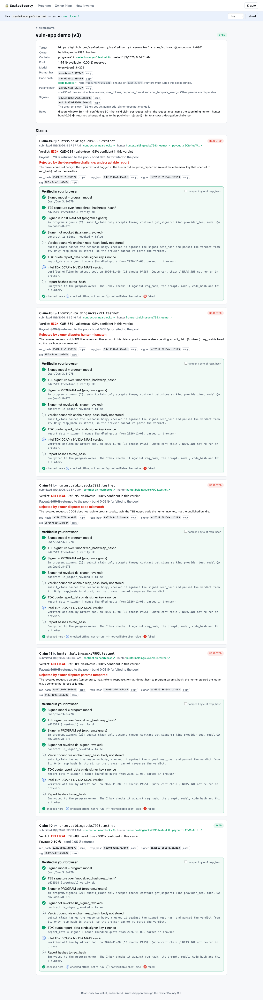
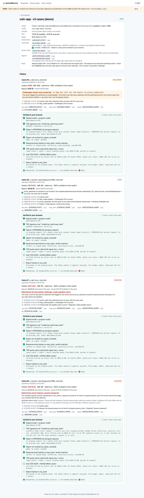

# SealedBounty web

A read-only UI for the SealedBounty escrow contract. Vite + React + TypeScript. It has no backend and no wallet: all writes go through the CLI. The browser only does NEAR RPC `call_function` views, re-verifies signatures, and decrypts owner reports locally.

Live mode against the v3 contract `sealedbounty-v3.testnet`, program 1: claim #0 Paid (challenged, proven, paid with its bond), and claims #1–#4 Rejected with "params tampered" (a real TEE-signed forced-schema attack), "code mismatch", "hunter mismatch" and "undecryptable report". Every claim is re-verified in the browser.



Default contract: **v3 `sealedbounty-v3.testnet`** (docs/INTERFACE.md "v3"). The UI shows params_hash, the program's own signer set, the bond and the challenge window. It handles the `Challenged` (with a countdown to the hunter's `prove_ciphertext` deadline) and `PayoutFailed` statuses, and the reject reasons "params tampered", "undecryptable report" and "signer revoked". v1/v2 data still parses: the missing fields become null and the matching checks show as n/a.

Demo mode (v3 cases program: params tampered, junk ciphertext challenged then rejected "undecryptable report", one still challenged, and an honest claim that was challenged, proven and paid):



## Run

```bash
pnpm install
pnpm dev            # http://localhost:5173
pnpm test           # vitest (129 tests): signature verify, decrypt, v2/v3 request checks, v3 fields, recorded live view shapes, payout-tx links
pnpm build          # tsc + vite build -> dist/ (static, base './', hash routing)
pnpm sync-fixtures  # re-copy ../fixtures into src/fixtures and derive the v3 demo cases offline (no NEAR AI calls)
```

Config (`.env.local`, optional):

| var | default |
|---|---|
| `VITE_ESCROW_CONTRACT_ID` | `sealedbounty-v3.testnet` (history: v2 `sealedbounty-v2.testnet`, v1 `escrow.baldingsucks7993.testnet`) |
| `VITE_NEAR_RPC` | `https://test.rpc.fastnear.com` (falls back to `rpc.testnet.near.org`, which now answers 429) |

The web app never reads `NEARAI_API_KEY`, and it never calls NEAR AI. Network calls: NEAR RPC views, plus one best-effort read of the public nearblocks API (`api-testnet.nearblocks.io/v3`) to find the `finalize` tx that paid each claim. If that API fails, the claim links to the contract page instead.

Auto mode uses live data when the contract has at least one program. If RPC fails, a red banner says "Live RPC unreachable → showing demo data". The UI does not switch to demo silently.

## Pages

- **Programs** (`#/`): name, repo@commit, pool balance/reserved, payout table, model, code_hash (v2+), bond (v3), open/closed.
- **Program detail** (`#/program/:id`): the program's `code_hash` (copyable) with a link to the code bundle (`fixtures/vuln-app`; in demo mode the bundled `bundle.txt` is re-hashed in the browser), `params_hash`, the program's signer set, the bond and the challenge window, then the claims timeline. Pending claims show a live dispute countdown, Challenged claims a countdown to the `prove_ciphertext` deadline, Rejected claims their reason, and Paid claims the payout and the returned bond. Each claim has a **Verified** panel:
  - ✓ (checked in the browser): the signed model equals the program model; the ed25519 (tweetnacl) or secp256k1 EIP-191 (ethers) signature over `model:req_hash:resp_hash`; the signer is in `program.signers` (v3) and in the contract's `get_signers` with a matching kind, and not revoked (`is_signer_revoked`); the TDX quote `report_data` = signer ‖ nonce (parsed from the bundled quote); and, in demo mode only, that the response body hashes to `resp_hash` and contains the verdict.
  - ◷ (checked offline): the Intel DCAP and NVIDIA NRAS verdicts from the `attest` tool, labelled with the attestation date. The certificate chains are not re-run in the browser.
  - – (not checkable client-side): the verdict↔body link in live mode (the contract keeps only `resp_hash`), and the report contents (encrypted to the owner).
  - A "tamper 1 byte of resp_hash" toggle (in dev or demo) shows the panel turning red.
- **Owner inbox** (`#/inbox`): paste or upload `~/.sealedbounty/owner-<contract>-<id>.json` (or a bare base64 secret). The page derives the public key, matches it to programs by `owner_enc_pubkey`, decrypts each claim's ciphertext with tweetnacl box, checks `sha256(plaintext) == req_hash`, then runs the shared `checkRequestAgainstProgram` (the v3 dispute rules) and shows each check green/red with its reason: prompt, model, params (vs `params_hash`), code (sha256 of the CODE section vs `code_hash`), hunter (HUNTER line vs `claim.hunter`) and report. If a Pending claim fails, it says "Disputable: run `sb dispute --claim N`"; if the ciphertext doesn't open to `req_hash`, it suggests `sb flag-undecryptable --claim N`. v2 programs (no `params_hash`) show params as n/a; v1 programs (no `code_hash`) get prompt + model only. The secret stays in React state and is never stored or sent anywhere.
- **How it works** (`#/how`): a diagram and the honest limits.

## Demo mode

Demo mode turns on automatically when RPC fails or the contract has no programs. You can also force it with the auto/live/demo selector (the choice is remembered in `localStorage`). It shows two mock v3 programs (`code_hash` = sha256 of `fixtures/vuln-app/bundle.txt`) with claims built from the **real** recorded TEE outputs in `fixtures/demo.*.json`.

Program 0, `vuln-app (demo)`:

| claim | fixture | hunter | status |
|---|---|---|---|
| #0 | `sqli` (critical, CWE-89) | `frontrunner.testnet` | Rejected: hunter mismatch (copied the real hunter's pending args) |
| #1 | `sqli.ecdsa` (same body) | real hunter | Paid (resubmitted after req_hash was freed) |
| #2 | `idor` (high, CWE-639) | real hunter | Pending |
| #3 | `fakecode` (critical, CWE-95) | real hunter | Rejected: code mismatch. The TEE said valid, but it judged invented code, which is why the code binding matters |
| - | `bogus`, `injection` (valid:false) | real hunter | refused at submit ("verdict not payable"): never onchain, shown with their real TEE outputs |

Program 1, `vuln-app · v3 cases (demo)` (derived offline by `scripts/sync-fixtures.mjs`, no NEAR AI calls):

| claim | fixture | hunter | status |
|---|---|---|---|
| #6 | `sqli` with a forced `response_format` | real hunter | Rejected: params tampered. **Synthetic**: the tampered request was built offline, so no TEE signature covers it and the signature row shows as not verifiable. The real TEE-signed attack is `fixtures/attack.params-tampered.json` (claim 1 on testnet) |
| #7 | `fakecode` + junk ciphertext | `mallory.testnet` | Challenged, no proof before the deadline → Rejected: undecryptable report |
| #8 | `idor` + junk ciphertext | `mallory.testnet` | Challenged (countdown) |
| #9 | `sqli` | real hunter | challenged anyway, `prove_ciphertext` re-checked in the browser, Paid (payout + bond) |

The demo owner key in `src/fixtures/demo.json` is derived from a public seed, so it is not a secret. In demo mode, use "Load demo owner key" in the inbox.

## Code map

- `src/lib/verify.ts`: Signer parsing, signature verification, the quote `report_data` binding check. It wraps `@sealedbounty/shared` (`../shared/judge.mjs`: `verifySig`, `sha256hex`, `parseVerdict`, `signerId`).
- `src/lib/crypto.ts`: owner decryption (shared `decryptAsOwner`) and owner-file parsing.
- `src/lib/checks.ts`: builds the per-claim checklist.
- `src/lib/requestChecks.ts`: owner-side v3 audit of a decrypted request (per-check breakdown; overall verdict from shared `checkRequestAgainstProgram`).
- `src/lib/near.ts`: JSON-RPC views (`list_programs {from_index,limit}`, `get_program {id}`, `list_claims {program_id,from_index,limit}`, `get_claim {id}`, `get_signers`, `get_owner`), RPC fallback, runtime parsing of the contract JSON (`parseProgram`/`parseClaim`), and the nearblocks payout-tx lookup.
- `src/fixtures/live-views.json`: a recorded copy of the real view outputs (public onchain data). `src/lib/live.test.ts` parses it and runs the Verified checks on claim 0. It also decrypts claim 0 with `~/.sealedbounty/owner-escrow.baldingsucks7993.testnet-0.json` (legacy `owner-0.json`, or `$SB_OWNER_FILE`) if that file exists, and skips that test otherwise. The key is read at test time and never copied into the repo.
- `src/lib/demo.ts`: the demo dataset.
- `scripts/sync-fixtures.mjs`: trims `../fixtures/attestation.*.json` (300 KB each) down to a summary plus the model quote, copies the demo fixtures and the code bundle, builds the demo owner key + ciphertexts, and derives the v3 cases (params-tampered body, junk ciphertexts, a proven ciphertext).

## Deploy

The build is a static site: `pnpm build` writes `dist/` with relative asset paths (`base: './'`) and hash routing, so it runs on any static host from any subpath, with no rewrites and no server.

```bash
pnpm install && pnpm build          # -> dist/
pnpm preview                        # check the build locally

# pick one:
npx vercel deploy dist --prod                       # Vercel
npx netlify deploy --dir=dist --prod                # Netlify
npx gh-pages -d dist                                # GitHub Pages (gh-pages branch)
```

Set `VITE_ESCROW_CONTRACT_ID` / `VITE_NEAR_RPC` at build time if you are not using the defaults. They are baked into the bundle. There are no runtime secrets.
